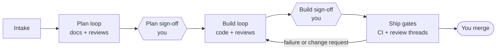

# Foundry

**From GitHub issue to merged pull request, with agents doing the work and you holding the gates.**

[](CHANGELOG.md)
[](LICENSE)
[](https://claude.com/claude-code)

Foundry is a plugin for [Claude Code](https://claude.com/claude-code) that turns a batch of related issues into one reviewed, documented pull request. An oversight agent plans the work, six specialist reviewers check it from every side, and nothing moves to the next stage until you sign off.

## Why Foundry

- **You decide; agents do the work.** You sign off the plan, sign off the implementation, and merge. Sign-off comes only from you: never from a GitHub comment, even one under your account.
- **Every perspective, every time.** Product owner, usability, accessibility, architecture, security and documentation reviewers all approve the plan and then the code. There's no majority vote, and disagreements come to you.
- **Documentation first.** Requirements, specification and decision records are written and reviewed before any code. User docs change in the same commits as the code they describe.
- **Gates the agent can't skip.** The Foundry mod enforces each stage inside Claude Code. Edits, commits, pushes and pull requests wait until their stage allows them.
- **Visible at a glance.** A side panel shows every batch as a card: its stage, its round, each reviewer's verdict, tests and CI, and a clear alert whenever something waits on you.

## How it works



1. **Intake** picks triaged issues from the current milestone, ordered by your project board's Priority and Size, and groups related ones into a batch.
2. **The plan loop** writes the plan and its docs. The reviewers review them together until every one approves.
3. **You sign off** the plan.
4. **The build loop** implements, tests and updates the docs. The reviewers review it until every one approves.
5. **You sign off** the implementation.
6. **The ship gates** open the pull request and wait until CI is green and nothing your online reviewers, such as CodeRabbit, raised is still open. A failure or a change request sends the work back to the build loop.

Each stage has a round limit, and reaching it escalates to you. You always merge. [Read the full walkthrough →](docs/how-it-works.md)

## Quick start

### Requirements

- [Claude Code](https://claude.com/claude-code) **2.1.321** or later
- The [GitHub CLI](https://cli.github.com/), signed in, with access to the repository and its project board
- Python 3

### Install

Foundry comes from its own marketplace, `brylie/foundry`: add the marketplace once, then install the plugin from it. In a Claude Code session:

```
/plugin marketplace add brylie/foundry
```

```
/plugin install foundry@foundry
```

From a shell, the same two steps:

```bash
claude plugin marketplace add brylie/foundry
```

```bash
claude plugin install foundry@foundry
```

In the Claude desktop app, click **+** next to the prompt box and choose **Add plugins** (or **Plugins**, then **Browse plugins**), add the marketplace `brylie/foundry`, then add Foundry.

### Upgrade

**In a Claude Code session,** run `/plugin`, open the **Installed** tab, choose Foundry, then **Update now**. Or update from the marketplace: run `/plugin marketplace update foundry`, then choose **Update marketplace**, which refreshes the listing and updates the plugins you installed from it.

**From a shell:**

```bash
claude plugin marketplace update foundry
```

```bash
claude plugin update foundry@foundry
```

The new version loads in your next session, or in the running one after `/reload-plugins`. `claude plugin list` shows the version you have.

**To update on its own,** turn on auto-update for the marketplace: in `/plugin`, open **Marketplaces**, choose `foundry`, then **Enable auto-update**. It's off by default for marketplaces outside Anthropic's own. Claude Code then updates Foundry in the background and tells you to run `/reload-plugins`.

**In the Claude desktop app,** the Code tab's plugin menu installs, enables and removes plugins, but has no documented update action. Update from a Claude Code session or a shell as above, or turn on auto-update.

Batches already running carry on: Foundry reads the state an earlier version wrote, keeping each batch's stage, reviews and any decision waiting on you. Before you upgrade, read the release's **Changed** and **Upgrading** notes in the [changelog](CHANGELOG.md). For 0.3.0, for example, remove `bot_timeout_minutes` from your `foundry.yaml`, since Foundry no longer reads it.

### Run your first batch

Open Claude Code in your repository, then see which issues Foundry would pick, without changing anything:

```
/foundry:begin dry run
```

Start a batch from a milestone, a theme, or specific issues:

```
/foundry:begin 42
```

The Foundry panel opens beside the chat. When a card says **Waiting on you**, decide with its buttons or with `/foundry approve`. The same buttons show on a card under the agent's request in the conversation, so you can decide from the Claude mobile app too.

## Configuration

Foundry works without configuration. To tailor it to a repository, add a `foundry.yaml` at its root:

```yaml
online_reviewers: [coderabbitai[bot]]
maintainers: [your-github-login]
max_rounds: 3
```

Foundry reads this file from your default branch only, so a pull request can't change the rules it's judged by. [See every setting →](docs/configuration.md)

## Documentation

| Guide | What's in it |
|---|---|
| [How it works](docs/how-it-works.md) | The stages, the rules, documentation first, the ship gates, and the panel |
| [Configuration](docs/configuration.md) | Plugin settings, `foundry.yaml`, doc folders, and the reviewer allowlist |
| [Reference](docs/reference.md) | The agents, the skills, and every `/foundry` command |
| [Security model](docs/security.md) | Where the state lives, what the guards refuse, and the trust boundary |
| [Specification](docs/specification.md) | What Foundry is built to do |
| [Changelog](CHANGELOG.md) | What changed in each release |

## Status

Foundry is young (0.x), and its behaviour can change between minor versions; the [changelog](CHANGELOG.md) says how. Its guards keep an agent following its instructions from skipping stages. They are a guardrail, not a sandbox: the agent works under your GitHub account. [Read the security model →](docs/security.md)

## Contributing

Contributions are welcome. [CONTRIBUTING.md](CONTRIBUTING.md) covers setup, the code layout, the checks every change passes, and the conventions.

## License

[Apache License 2.0](LICENSE)
