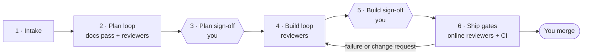

# How Foundry works

Foundry takes a **batch** of related GitHub issues to one merged pull request through six stages. Agents do the work and review it; you sign off at two points and merge at the end. The Foundry mod enforces each stage inside Claude Code, so a step can't run before its stage allows it.

- [The stages](#the-stages)
- [The rules](#the-rules)
- [Documentation first](#documentation-first)
- [The ship gates](#the-ship-gates)
- [The panel](#the-panel)

## The stages

| Stage | What happens | The mod holds back |
|---|---|---|
| **1. Intake** | Triaged issues from the current milestone, ordered by the project board's **Priority** and **Size**, are grouped into batches, one pull request each. | |
| **2. Plan loop** | The oversight agent writes the plan, and the docs pass writes the requirements, specification and decision records. The reviewers review them together until all approve. | Code (only the requirement, specification and decision folders may change), `git commit`, claiming issues |
| **3. Plan sign-off** | You approve the plan and its docs. | Everything, while you decide |
| **4. Build loop** | The agent builds, tests, and updates the user docs with the code, and opens a **draft** pull request so you can read the change on GitHub. The reviewers review until all approve. | A pull request for review (`gh pr create` without `--draft`, `gh pr ready`) |
| **5. Build sign-off** | You approve the implementation. | Everything, while you decide |
| **6. Ship gates** | The agent marks the pull request ready for review. CI goes green and nothing the allowlist raised stays open. A failure or change request sends the work back to the build loop. | Edits and commits, until the work is sent back |
| *(always)* | | `gh pr merge`: you merge |

An issue is **triaged** when the project board has its Priority and Size set and its Status is the board's first option (usually Todo).

By default six reviewers must approve each loop: **product owner, usability, accessibility, architecture, security and documentation**. A repository can change that list; see [Configuration](configuration.md).

## The rules

- **Every reviewer approves.** There is no majority: a sign-off reaches you only once every required reviewer's latest verdict is *ready*.
- **Round limit.** Each stage has a round limit (default 3). Hitting it escalates to you.
- **Counters reset forward.** The round counter resets when work moves to the next stage.
- **CI failures count.** A CI failure or a change request on the pull request counts as a ship round. A plain rerun of a flaky test does not.
- **Conflicts escalate.** When reviewers want things that can't both hold, the decision comes to you. You veto one, which then counts as approved for that stage, or you write a compromise.
- **Sign-off is yours alone.** Sign-offs come only from the panel's buttons, your answer to the question Foundry asks you, or your own `/foundry` command. A GitHub comment never counts as one, even under your account (some reviewer bots post as you), and neither does a message from another session or a plain "approved" in the chat.
- **Decide from anywhere.** When a batch waits on you, Foundry asks you in a question card as the agent's turn ends: Approve or Request changes for a sign-off, the buttons' choices for the other waits. It shows wherever you follow the session, your phone included, where the panel doesn't, and it offers every choice: past four, pick "Overrule a reviewer…" and a second question asks which. Words you type under "Other" ask for changes, or for a conflict are the compromise, and reach the agent as yours. Words that decide nothing in a wait aren't lost: the question is asked again, saying so. A wait with one choice also offers **Not yet**, which leaves it open. A question you dismiss isn't asked again, and the agent's message names the command to type instead, such as `/foundry approve #12`, which works from your phone too.

## Documentation first

A change isn't done until what people read about it is true, so Foundry treats docs as part of the work.

- **The docs pass, in the plan loop, before any code.** The product owner updates the **requirements**: what users can do, and why. Then architecture writes the technical design into the **specification** beside the product owner's section, and adds a **decision record** for each significant choice. Every reviewer reviews the plan and that doc diff together, and your plan sign-off agrees both.
- **The plan is a file.** The oversight agent writes the plan to `docs/plans/<lead issue>.md` on the batch's branch and revises it there. Each card's **Plan** button shows it, read from your checkout, and it's committed with the agreed docs once you sign it off.
- **A copy of the plan on the lead issue.** At each review and sign-off, the mod copies the plan file into a comment on the lead issue, rewriting it only when the plan changed. It reads anywhere, the GitHub app on your phone included, and the card, the question and the agent's message link to it. The file stays the plan: edits to the copy are replaced.
- **Only docs before the sign-off.** In the plan stage the mod lets the plan file and the requirement, specification and decision folders change, and nothing else. A reviewer agent may edit those folders only while the batch is planning, and never commits, pushes or touches code.
- **Docs with the code, in the build loop.** The first commit is the docs you agreed. User and reference docs, help pages, the README and the changelog change in the same commits as the code they describe. If the code has to differ from the agreed spec, the agent stops and asks you.
- **A documentation reviewer, in both loops.** In the plan loop it checks that the plan names every doc the change touches. In the build loop it checks that each one was updated, matches the code, and that nothing went stale.

Where each kind of doc lives is set per repository; see [doc folders](configuration.md#doc-folders).

## The ship gates

Once the pull request is open, the mod reads it every minute and judges it only on facts GitHub records.

- **CI:** every check passes. Codecov's status checks (`codecov/patch`) count as CI. No checks yet, right after a push, counts as pending, not green.
- **Nothing open:** no review from the [allowlist](configuration.md#the-allowlist) requests changes, and none of its review threads is unresolved. The agent replies in threads and resolves them once fixed. An online reviewer's resolved thread still blocks until that reviewer has reviewed a commit newer than the one it was raised on, so resolving without a fix clears nothing.
- **No waiting on the online reviewers.** The gate doesn't wait for them to review. What they find arrives as a change request or a thread, which the agent picks up, and which holds the pull request until it's fixed. Reviews and threads from anyone off the allowlist are ignored by the gate and listed for you.

When all of it is green, the card says **Ready to merge**. The merge is yours; the mod sees it and closes the batch.

## The panel

The Foundry panel sits beside the chat and shows one card per batch, moving down the stages. It opens when a batch starts or needs you, and on demand with `/foundry pane`. Each card shows:

- **The track:** Plan ▸ Plan sign-off ▸ Build ▸ Build sign-off ▸ Ship ▸ Done.
- **The round counter.**
- **Status lights for each reviewer:** ✓ ready, ~ revise, ✗ rethink, ○ not reviewed, ⊘ vetoed.
- **Tests and CI lights,** plus the open review threads.
- **Anyone outside the allowlist** who commented, listed for you to read.
- **A "waiting on you" alert** with the buttons for your decision:

| Alert | Your buttons |
|---|---|
| Sign-off | Approve, Request changes |
| Round limit reached | Approve, Another round, Veto a reviewer (loops); Send back anyway, End batch (ship) |
| Reviewer conflict | Veto a reviewer, I'll write a compromise |
| Ready to merge | (merge on GitHub) |
| State edited outside Foundry | OK |

Every button has a `/foundry` command too; see [Reference](reference.md#the-foundry-command). Each card also has a **Plan** button that shows the batch's plan file.

The panel shows on the desktop app and in the terminal. On your phone, answer in the question card Foundry asks, or type the command.
